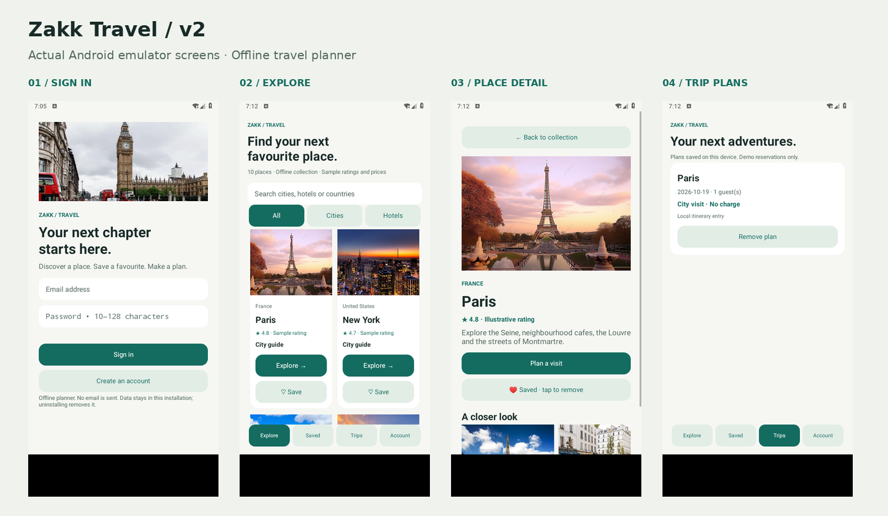

# Zakk Travel 2

An offline Android travel planner upgraded from Zakaria Brim's July 2024 coursework source. This upgrade adds local accounts, persistent favorites and trip plans, a redesigned interface, sample stay totals, photo galleries and input validation. The 2024 coursework is preserved separately; the added features are a later upgrade.

The frontend uses native Java Activities, RecyclerView cards, XML themes and bundled photos. The local backend uses private SQLite tables with foreign keys and account-scoped queries. Passwords use salted PBKDF2-HMAC-SHA256 with 600,000 iterations and run off the UI thread. Sessions persist; users can sign out or delete their local account.

This app has no remote API, live hotel availability, real reservations, payments, email verification, password recovery or cloud sync. Prices and ratings are sample data. Hotel stays are explicitly labeled demo plans. Uninstalling deletes local data. Passwords are hashed, but the local database is not encrypted against device compromise.

## Run

Open this folder in Android Studio with JDK 17 and Android SDK 34. Run `app` on an Android 8.0 / API 26 or newer device. Create an account with an email-shaped identifier and a password of 10–128 characters; no email is sent. There is no default admin account.

On Linux/macOS use `bash gradlew :app:assembleDebug`; on Windows use `gradlew.bat :app:assembleDebug`. Initial development dependency downloads require Internet access; the app itself works offline.

Source namespace is retained as `com.example.login`; the application ID is `com.zakk.travel`, allowing installation separately from the original coursework app. Original image assets are retained without granting new third-party licensing rights.

Read `docs/UPGRADE_REPORT.md` for the frontend/backend summary and `docs/VERIFICATION.md` for measured checks and limitations. No claim of GitHub CI execution is made merely because a workflow is supplied.

## Actual app screens

Full-resolution captures are in `docs/screenshots/`. They show the real app running with synthetic test data, not generated UI mockups.
